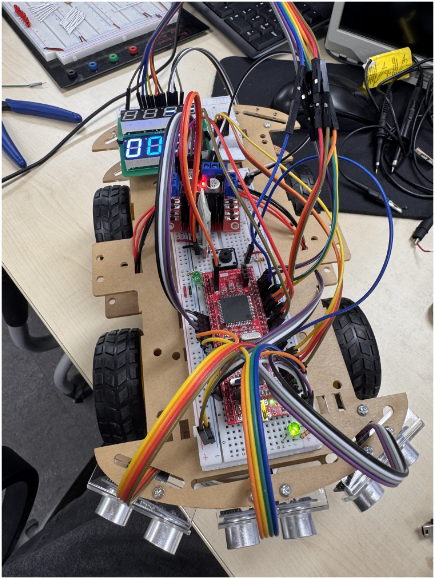
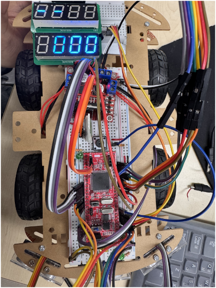
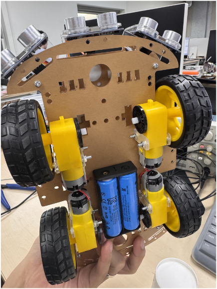
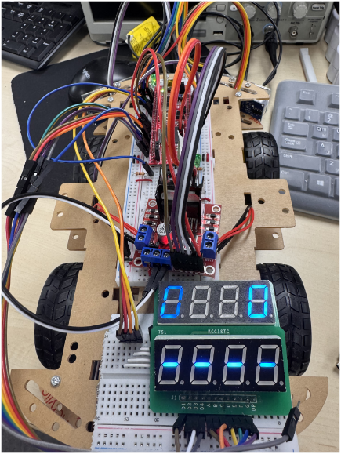
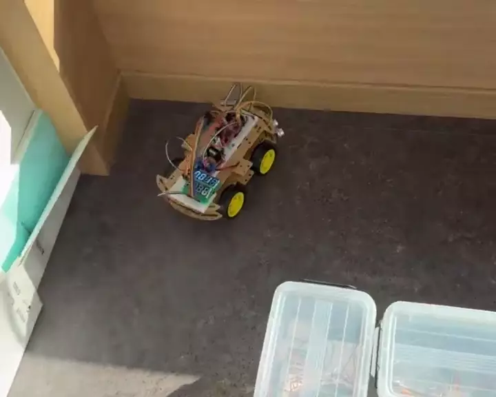
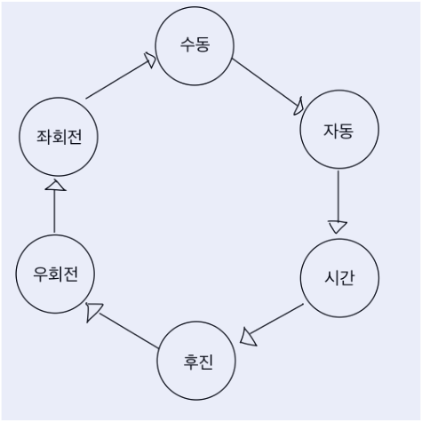
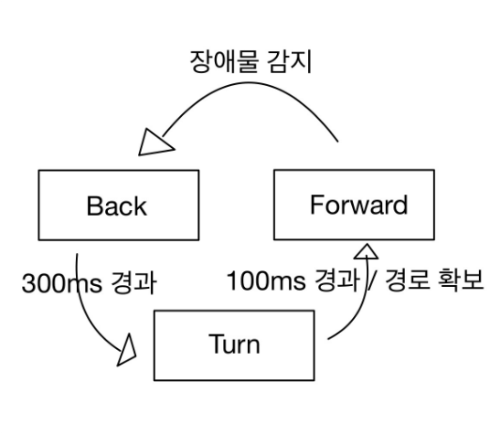
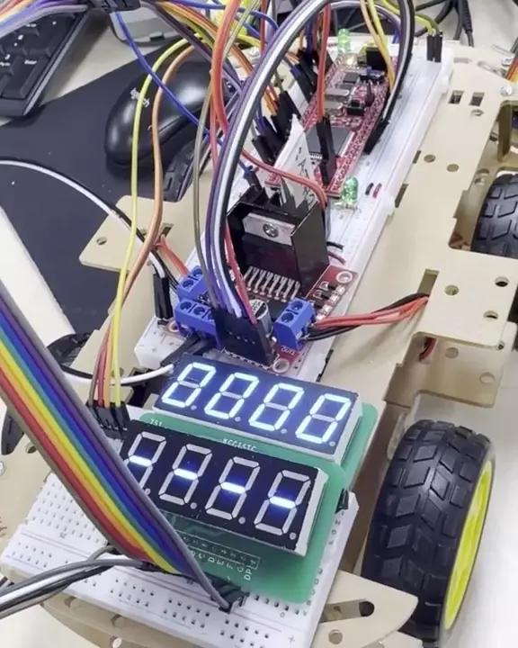

# ATmega128A 초음파 센서 기반 자율주행차

AVR 마이크로컨트롤러와 초음파 센서를 활용해 장애물을 감지하고 회피하는 자율주행차 프로젝트입니다. 수동 조작과 자율주행 모드를 지원하며, FND로 주행 상태와 운행 정보를 확인할 수 있습니다.

## 프로젝트 목표

- 초음파 센서로 전방·좌측·우측의 장애물을 실시간 감지
- AVR 기반으로 DC 모터의 방향과 속도를 제어
- 센서 거리값에 따라 안전한 방향으로 회피 주행
- 수동/자동 모드와 FND 상태 표시 구현

## 구성 및 외관

| 정면 | 후면 |
| --- | --- |
|  |  |

| 아랫면 | 윗면 |
| --- | --- |
|  |  |

## 핵심 기능

### Manual Mode

버튼 입력으로 정지, 전진, 후진, 좌회전, 우회전을 제어합니다.

- 정지: 모터 정지, FND에 `----` 표시
- 좌회전: 오른쪽 모터만 동작, FND에 `E---` 표시
- 우회전: 왼쪽 모터만 동작, FND에 `---∃` 표시
- 후진: 양쪽 모터 역방향 동작
- 전진: 양쪽 모터 정방향 동작

### Auto Mode

세 방향의 거리값을 기준으로 주행합니다.

- 전진 조건: 전방 `M > 40`, 좌측 `L > 20`, 우측 `R > 20`
- 전방 장애물 감지: `M ≤ 40`이면 300 ms 후진해 공간을 확보한 뒤, 좌·우 거리값을 비교해 더 넓은 방향으로 회전
- 측면 장애물 감지: `L ≤ 20` 또는 `R ≤ 20`이면 반대 방향으로 회전해 경로를 보정

## 상태 전이

버튼 1을 누를 때마다 수동/자동 모드를 전환합니다. 자율주행 중 장애물을 감지하면 후진, 회전, 전진 순서로 동작합니다.

| 모드 전환 FSM | 자율주행 FSM |
| --- | --- |
|  |  |

## FND 표시

첫 번째 FND는 현재 주행 상태를 표시하고, 두 번째 FND는 주행 시간·후진 횟수·우회전 횟수·좌회전 횟수를 순환 표시합니다.

## 개선 과제

- FND 애니메이션 효과 구현
- Auto Mode에서 장애물이 있을 때 앞뒤로 반복 이동하는 현상 완화
- 모터 제어 예외 처리와 배선 안정성 개선

## 발표 자료

프로젝트 발표일: 2026.06.23  
발표자: 이규현
