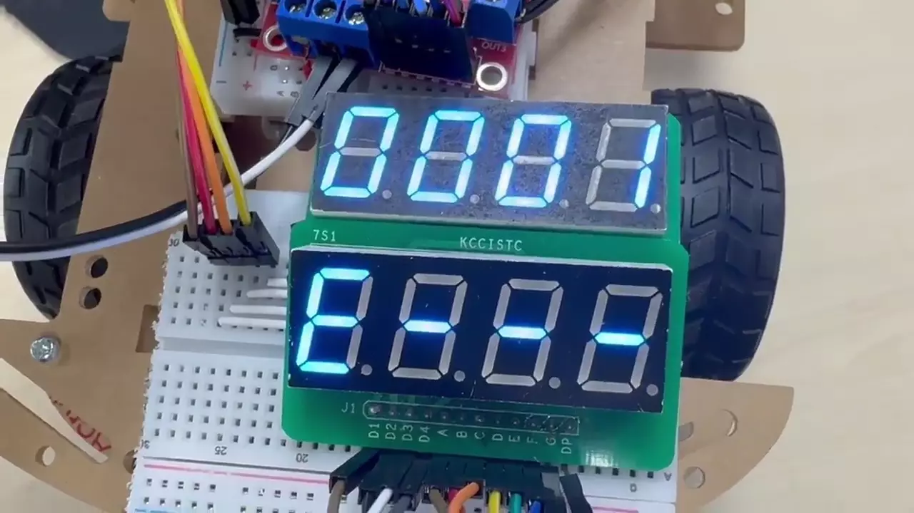

# ATmega128A 초음파 센서 기반 자율주행 RC카

> 대한상공회의소 서울기술교육센터 AI 시스템반도체 SW개발자 과정 · AVR 개인 프로젝트

| | |
|---|---|
| 📅 **기간 · 인원** | 2026.06.16 ~ 2026.06.23 · 개인 프로젝트 |
| 🙋 **담당** | 하드웨어 조립 · 배선, 펌웨어 전체 (모터 PWM, 초음파 3채널 측정, 모드 전환 · 자율주행 FSM, FND 표시, 블루투스 수동 조작) |
| 🛠️ **사용 기술** | C · ATmega128A · Timer/PWM · 외부 인터럽트 · UART(HC-06) · L298N · HC-SR04 × 3 |
| 📈 **결과** | 전방 40cm · 측면 20cm 기준 장애물 회피 주행, 수동 · 자동 모드 전환, FND 2개로 주행 상태와 운행 기록 표시 |

초음파 센서 3개로 전방 · 좌측 · 우측 거리를 재고, 장애물이 가까워지면 **후진 → 넓은 쪽으로 회전 → 전진** 순서로 피해 가는 RC카입니다.
버튼 하나로 블루투스 수동 조작과 자율주행을 전환하고, FND로 현재 동작과 주행 기록을 보여 줍니다.

<p align="center">
  
  
  
  
</p>
<p align="center">정면 · 후면 · 윗면 · 아랫면</p>

📑 [발표자료 (PDF)](docs/presentation/자율주행_RC카_발표자료.pdf) · 원본: [발표 pptx](docs/presentation/자율주행_RC카_발표자료.pptx)

## 시연 영상

<table>
  <tr>
    <th width="33%">Manual Mode (블루투스 조작)</th>
    <th width="33%">Auto Mode (장애물 회피)</th>
    <th width="33%">FND 표시 전환</th>
  </tr>
  <tr>
    <td><a href="docs/videos/car_manual.mp4"></a></td>
    <td><a href="docs/videos/car_auto.mp4"></a></td>
    <td><a href="docs/videos/car_fnd.mp4"></a></td>
  </tr>
</table>

## 구성 요소

| 부품 | 수량 | 역할 |
|---|---|---|
| ATmega128A | 1 | 전체 제어 |
| 초음파 센서 HC-SR04 | 3 | 전방 · 좌측 · 우측 거리 측정 |
| 모터 드라이버 L298N | 1 | DC 모터 방향 · 속도 제어 |
| DC 모터 | 4 | 구동 |
| 블루투스 모듈 HC-06 | 1 | 수동 모드 조작 명령 수신 |
| FND (7-Segment 4자리) | 2 | 주행 상태 · 운행 기록 표시 |
| 푸시 버튼 | 1 | 모드 전환 · FND 표시 전환 |

## 동작 방식

### 모드 전환 · 자율주행 FSM

| 모드 전환 FSM | 자율주행 FSM |
|---|---|
|  |  |
| 버튼 1을 누를 때마다 Manual ↔ Auto 전환 | 장애물 감지 → 300ms 후진 → 넓은 쪽으로 회전 → 경로 확인 후 전진 |

### Manual Mode

블루투스로 받은 문자로 모터를 제어하고, FND 1에 현재 동작을 표시합니다.

| 명령 | 모터 | FND 1 |
|---|---|---|
| `F` 전진 | 양쪽 모터 정방향 | `⨅⨅⨅⨅` |
| `B` 후진 | 양쪽 모터 역방향 | `⨆⨆⨆⨆` |
| `L` 좌회전 | 오른쪽 모터만 동작 | `E---` |
| `R` 우회전 | 왼쪽 모터만 동작 | `---∃` |
| `S` 정지 | 모터 정지 | `----` |

### Auto Mode

세 방향 거리값(전방 M, 좌측 L, 우측 R, 단위 cm)으로 주행을 결정합니다.

| 조건 | 동작 |
|---|---|
| `M > 40` 이고 `L > 20`, `R > 20` | 전진 |
| 전방 장애물 `M ≤ 40` | 300ms 후진해 공간 확보 → L과 R을 비교해 더 넓은 쪽으로 회전 |
| 측면 장애물 `L ≤ 20` 또는 `R ≤ 20` | 반대 방향으로 회전해 경로 보정 |

<p align="center"></p>

### FND 표시

| FND 1 (현재 동작) | FND 2 (버튼으로 순환) |
|---|---|
| 정지 · 전진 · 후진 · 좌회전 · 우회전 | 주행 시간 → 후진 횟수 → 우회전 횟수 → 좌회전 횟수 |

<p align="center"></p>

## 폴더 구조

> 저장소의 `07.AUTO_CAR`는 수동 모드(블루투스 조작)까지 구현한 중간 버전입니다. 최종 Auto Mode 주행 FSM 코드는 [발표자료](docs/presentation/자율주행_RC카_발표자료.pdf) 9 ~ 11쪽 코드 설명에 있습니다.

```
ATmega128a_AUTO_CAR/
├── 07.AUTO_CAR/          Microchip Studio 프로젝트
│   ├── main.c            함수 포인터 기반 모드 디스패치, Manual 모드 (블루투스 명령)
│   ├── ultrasonic.c/h    HC-SR04 3채널 거리 측정
│   ├── pwm.c/h           모터 PWM · 방향 제어
│   ├── uart0.c, uart1.c  디버그 출력 · 블루투스 수신
│   ├── button.c/h        모드 전환 버튼
│   └── led.c/h           FND · LED 표시
├── assets/images/        README 사진
└── docs/
    ├── presentation/     발표자료 (PDF, pptx)
    └── videos/           시연 영상 원본
```

## 결과와 개선할 점

- **결과**: 전방 · 측면 기준 거리로 장애물을 피해 주행하고, 수동 · 자동 모드와 FND 표시를 버튼 하나로 전환하는 것을 확인했습니다.
- **개선할 점**: Auto Mode에서 장애물이 가까이 있으면 후진과 전진을 너무 자주 반복합니다. 회전 후 경로 확인 시간을 늘리거나 거리 기준에 히스테리시스를 두어 완화할 수 있습니다. FND 애니메이션 효과는 구현하지 못했습니다.
- **배운 점**: 모터를 다루면서 예외 상황(센서 값 튐, 연속 명령) 처리가 중요하다는 것을 알았고, 배선 문제가 생각보다 자주 생긴다는 것도 경험했습니다.
